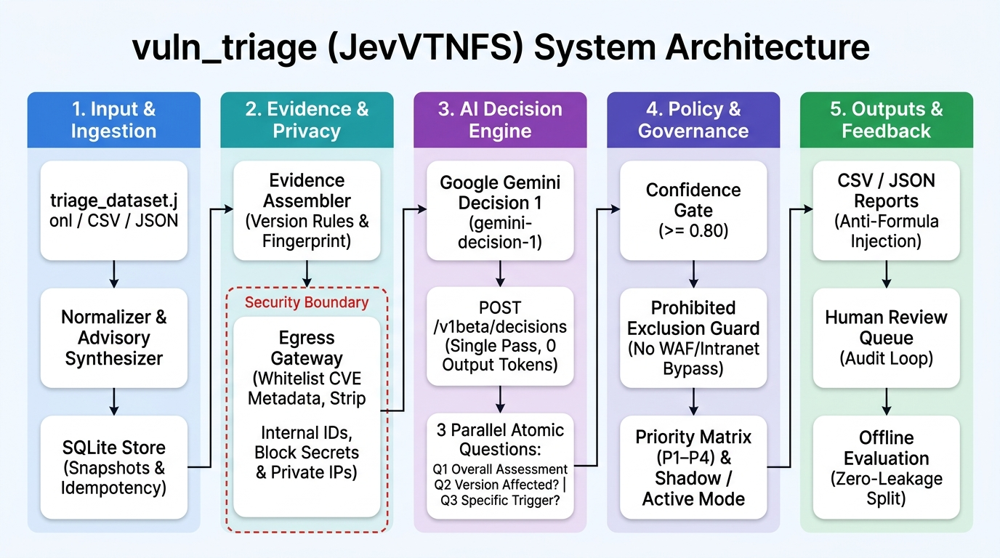
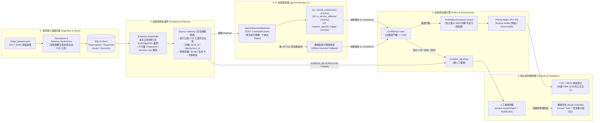

# 漏洞分流與雜訊過濾系統 (`vuln_triage` / JevVTNFS)

依據 [SYSTEM_DESIGN.md](SYSTEM_DESIGN.md) 實作之軟體套件組成分析（SCA）漏洞分流、雜訊過濾、隱私保護與審核評估系統。詳細指令與資料合約請參閱 [UserGuide.md](UserGuide.md)。

---

## 系統架構圖 (System Architecture)



<details>
<summary>展開檢視 Mermaid 向量架構圖原始碼</summary>



</details>

---

## 核心特色

- **證據可追溯與冪等性**：每一筆判定綁定不可變 `EvidenceBundle`、唯一 `fingerprint` 與 `decision_key`，重複執行自動跳過（`Idempotent skip`）。
- **處置可解釋**：以政策矩陣明確劃分技術判定（`AFFECTED` / `NOT_AFFECTED` / `UNKNOWN` / `FIXED`）與處置動作（`PRIORITIZE_REMEDIATION` / `SCHEDULE_REMEDIATION` / `HUMAN_REVIEW` / `SUPPRESS_UNTIL`）。
- **Google `gemini-decision-1` 判定模型架構**：整合 Google Gemini Decisions API（`POST /v1beta/decisions`），透過 3 個並行原子問題（`overall_assessment`, `is_version_affected`, `requires_specific_trigger`）於一次前向傳播中完成零輸出 Token 判定，具備校準信賴度閘控（預設 `>= 0.80`）與離線確定性回退機制。
- **原生 `.jsonl` 資料集與 GigaCRA / NVD 證據增強**：原生支援 935 筆 VEX/CVE 資料集 (`examples/triage_dataset.jsonl`)，匯入時自動合成 `AdvisorySnapshot`，並支援透過 `scripts/fetch_enrichment_cache.py` 與 `scripts/apply_enrichment.py` 補齊 NVD/GigaCRA 版本邊界與部署證據。
- **隱私邊界閘道 (`EgressGateway`)**：外部 API 呼叫強制經欄位白名單與去識別化遮蔽，自動阻擋私密金鑰、Email、內部路徑與 RFC1918 私有 IP（Fail-Closed `EGRESS_BLOCKED`）。
- **預設 Shadow Mode 與防公式注入**：預設僅記錄處置建議而不啟動自動抑制，確保不造成漏件風險；CSV 報表內建 CWE-1236 公式注入防禦。
- **零洩漏評估**：以案件譜系（Lineage / `issue_key`）嚴格切分訓練/驗證/測試集。

---

## 快速上手

### 1. 環境安裝與 API 金鑰設定

於專案根目錄建立 `.env`（若未設定金鑰，系統將自動啟用離線啟發式模型，仍可完整執行測試與評估）：
```bash
GEMINI_API_KEY=AIzaSy...您的GoogleAIStudio金鑰
```

#### Linux / macOS
```bash
uv venv .venv
source .venv/bin/activate
uv pip install -e .
```

#### Windows PowerShell
```powershell
uv venv .venv
.venv\Scripts\Activate.ps1
uv pip install -e .
```

---

### 2. 執行分流與評估流程

啟用虛擬環境後，在 Linux/macOS 與 Windows PowerShell 皆可直接執行 `triage` 指令：

```bash
# 1. 初始化資料庫與執行目錄
triage init

# 2. 匯入 935 筆 VEX/CVE JSONL 資料集（自動合成 Advisories 與 Observations）
triage import examples/triage_dataset.jsonl --kind findings --source jsonl

# 3. 執行 Shadow 模式分流（預設處理 850 筆 under_investigation，可用 --limit 測試或 --all 全量執行）
triage run --batch default --mode shadow --limit 10

# 4. 執行 Ground Truth 離線評估報告（零洩漏分組）
triage evaluate --config configs/evaluation.example.yaml

# 5. 產出分流處置報表（支援 csv / json）
triage report --batch default --format csv --output var/reports/triage_report.csv
```

---

## 進階證據增強腳本 (`scripts/`)

搭配 GigaCRA / NVD 快取進行證據增強與批次對比：
- `scripts/fetch_enrichment_cache.py`：擷取 NVD / GigaCRA 漏洞版本邊界與組件證據快取。
- `scripts/apply_enrichment.py`：將增強證據套用至待評估資料並匯入快照庫。
- `scripts/compare_batches.py`：比對不同批次或增強前後的分流判決差異。
- `configs/evaluation.gigacra.yaml`：GigaCRA 增強後之離線評估組態。

---

## 測試驗證

```bash
pytest tests/ -v
```
目前完整測試套件包含 **33 項單元與整合測試**（涵蓋 `.jsonl` 匯入、NVD/GigaCRA 版本邊界規則、`gemini-decision-1` API 模擬、信賴度門檻閘控、`EgressGateway` 洩漏攔截、人工審核與零洩漏離線評估）。
